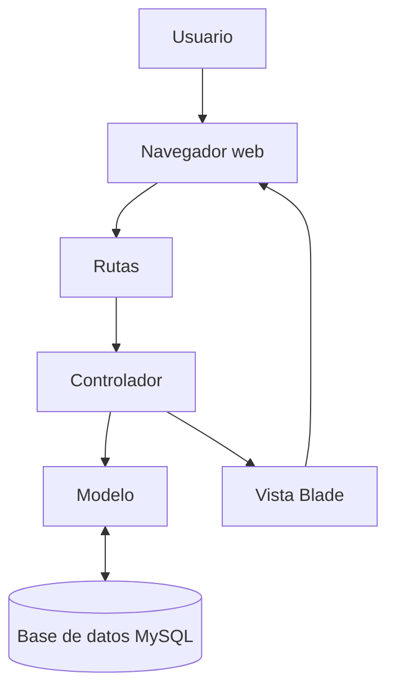
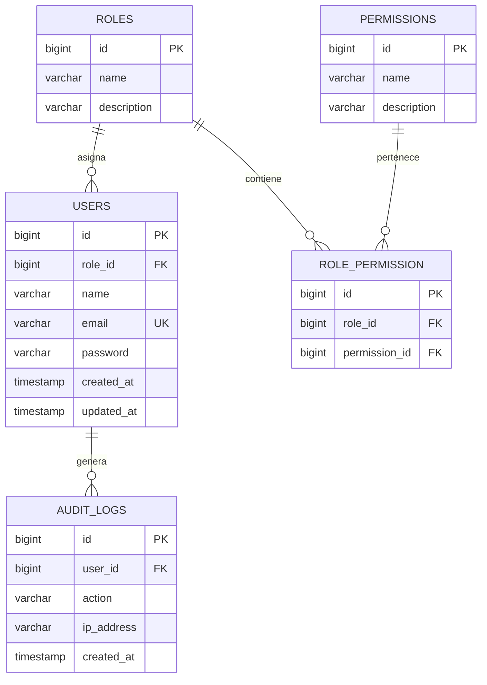

<p align="center"><a href="https://laravel.com" target="_blank"></a></p>


# Taller de desarrollo de aplicaciones web con Laravel

## 1. Descripción del proyecto

El presente taller tiene como finalidad desarrollar una aplicación web utilizando el framework Laravel, implementando una arquitectura Modelo-Vista-Controlador (MVC), conexión con una base de datos relacional y gestión de dependencias mediante Composer y npm.

El proyecto permite aplicar conocimientos relacionados con el desarrollo de software, la administración de bases de datos y la seguridad de aplicaciones web.

## 2. Objetivos del taller

- Comprender la arquitectura MVC.
- Configurar un entorno de desarrollo con Laravel.
- Implementar una base de datos relacional.
- Gestionar dependencias mediante Composer y npm.
- Implementar operaciones CRUD.
- Aplicar mecanismos de autenticación y control de acceso.
- Comprender la estructura de una aplicación web.

## 3. Tecnologías utilizadas

| Tecnología | Función |
|---|---|
| Laravel | Framework de desarrollo web |
| PHP | Lenguaje de programación Backend |
| MySQL | Sistema gestor de bases de datos |
| HTML5 | Estructura de interfaces |
| CSS3 | Diseño de interfaces |
| JavaScript | Interactividad |
| Composer | Gestor de dependencias PHP |
| Node.js | Entorno de ejecución JavaScript |
| npm | Gestor de dependencias JavaScript |
| Vite | Compilación de recursos Frontend |
| Git | Control de versiones |

## 4. Requisitos previos

Antes de ejecutar la aplicación, se deben instalar las siguientes herramientas:

- PHP (versión compatible con el proyecto).
- Composer.
- MySQL o MariaDB.
- Node.js.
- npm.
- Git.
- Visual Studio Code.

Para verificar la instalación de las herramientas, ejecutar:

```bash
php -v
composer -V
node -v
npm -v
git --version
mysql --version
```

## 5. Instalación del proyecto

### 5.1. Clonar el repositorio

```bash
git clone URL_DEL_REPOSITORIO
cd NOMBRE_DEL_PROYECTO
```

### 5.2. Instalar las dependencias de PHP

```bash
composer install
```

Para actualizar las dependencias:

```bash
composer update
```

### 5.3. Instalar las dependencias de JavaScript

```bash
npm install
```

Para actualizar las dependencias:

```bash
npm update
```

## 6. Configuración del entorno

Crear el archivo de configuración .env.

En Linux:

```bash
cp .env.example .env
```

En Windows (CMD):

```bash
copy .env.example .env
```

Generar la clave de seguridad de la aplicación:

```bash
php artisan key:generate
```

## 7. Configuración de la base de datos

Ingresar al gestor de bases de datos MySQL y crear una nueva base de datos.

```sql
CREATE DATABASE taller_laravel;
```

Modificar los siguientes parámetros en el archivo .env:

```ini
APP_NAME=Laravel
APP_ENV=local
APP_DEBUG=true
APP_URL=http://localhost:8000

DB_CONNECTION=mysql
DB_HOST=127.0.0.1
DB_PORT=3306
DB_DATABASE=taller_laravel
DB_USERNAME=root
DB_PASSWORD=
```

Los parámetros de conexión deben ajustarse de acuerdo con la configuración del servidor de bases de datos.

## 8. Migraciones de la base de datos

Ejecutar las migraciones para crear las tablas:

```bash
php artisan migrate
```

Consultar el estado de las migraciones:

```bash
php artisan migrate:status
```

Si el proyecto cuenta con datos iniciales mediante seeders:

```bash
php artisan db:seed
```

Para reconstruir completamente la base de datos en un entorno de desarrollo:

```bash
php artisan migrate:fresh --seed
```

ADVERTENCIA: El comando migrate:fresh elimina todas las tablas y sus datos.

## 9. Ejecución de la aplicación

Iniciar el servidor de desarrollo de Laravel:

```bash
php artisan serve
```

En una segunda terminal, ejecutar:

```bash
npm run dev
```

Ingresar desde el navegador a:

http://127.0.0.1:8000

Para compilar los recursos destinados a producción:

```bash
npm run build
```

## 10. Arquitectura de la aplicación

La aplicación se estructura mediante el patrón de arquitectura MVC (Modelo-Vista-Controlador).



### Modelo

Gestiona los datos y la comunicación con la base de datos.

### Vista

Presenta la información y las interfaces al usuario.

### Controlador

Procesa las solicitudes, aplica la lógica de negocio y coordina la comunicación entre los modelos y las vistas.

## 11. Diseño de la base de datos

El siguiente modelo entidad-relación representa una estructura de referencia para una aplicación con gestión de usuarios, roles, permisos y auditoría.



## 12. Diccionario de datos

| Tabla | Descripción |
|---|---|
| users | Almacena los usuarios registrados |
| roles | Define los tipos de usuario |
| permissions | Almacena los permisos del sistema |
| role_permission | Relaciona los roles con los permisos |
| audit_logs | Registra las actividades de los usuarios |

## 13. Estructura del proyecto

```text
proyecto/
├── app/
│   ├── Http/
│   │   └── Controllers/
│   ├── Models/
│   └── Providers/
├── bootstrap/
├── config/
├── database/
│   ├── factories/
│   ├── migrations/
│   └── seeders/
├── public/
├── resources/
│   ├── css/
│   ├── js/
│   └── views/
├── routes/
│   └── web.php
├── storage/
├── tests/
├── vendor/
├── node_modules/
├── .env
├── .env.example
├── artisan
├── composer.json
├── package.json
└── README.md
```

## 14. Comandos adicionales de Laravel

| Comando | Descripción |
|---|---|
| php artisan serve | Iniciar el servidor |
| php artisan migrate | Ejecutar migraciones |
| php artisan migrate:status | Consultar migraciones |
| php artisan db:seed | Insertar datos iniciales |
| php artisan route:list | Consultar rutas |
| php artisan cache:clear | Limpiar caché |
| php artisan config:clear | Limpiar configuración |
| php artisan optimize:clear | Limpiar archivos de optimización |
| php artisan storage:link | Crear enlace de almacenamiento |
| php artisan test | Ejecutar pruebas |
| composer update | Actualizar dependencias PHP |
| npm update | Actualizar dependencias JavaScript |
| npm run dev | Ejecutar Vite en desarrollo |
| npm run build | Compilar recursos Frontend |

## 15. Seguridad de la aplicación

Durante el desarrollo se recomienda implementar los siguientes mecanismos de seguridad:

- Autenticación de usuarios.
- Almacenamiento de contraseñas mediante hashing.
- Validación de datos de entrada.
- Protección contra inyección SQL.
- Protección contra ataques CSRF.
- Control de acceso basado en roles.
- Principio de mínimo privilegio.
- Registro y auditoría de actividades.
- Actualización de dependencias.
- Protección del archivo .env.
- Copias de seguridad de la base de datos.

El archivo .env no debe publicarse en repositorios Git.

## 16. Resultados de aprendizaje

Al finalizar el taller, el estudiante estará en capacidad de configurar, ejecutar y administrar una aplicación web desarrollada con Laravel, comprender su arquitectura, gestionar una base de datos relacional e identificar mecanismos básicos de seguridad informática.

## 17. Autor

Nombre del estudiante:

Asignatura: Seguridad Informática

Institución:

Año: 2026

## 18. Referencias

- Laravel: https://laravel.com/docs
- PHP: https://www.php.net/docs.php
- Composer: https://getcomposer.org/doc/
- Node.js: https://nodejs.org/
- MySQL: https://dev.mysql.com/doc/
- OWASP: https://owasp.org/
- Mermaid: https://mermaid.js.org/
